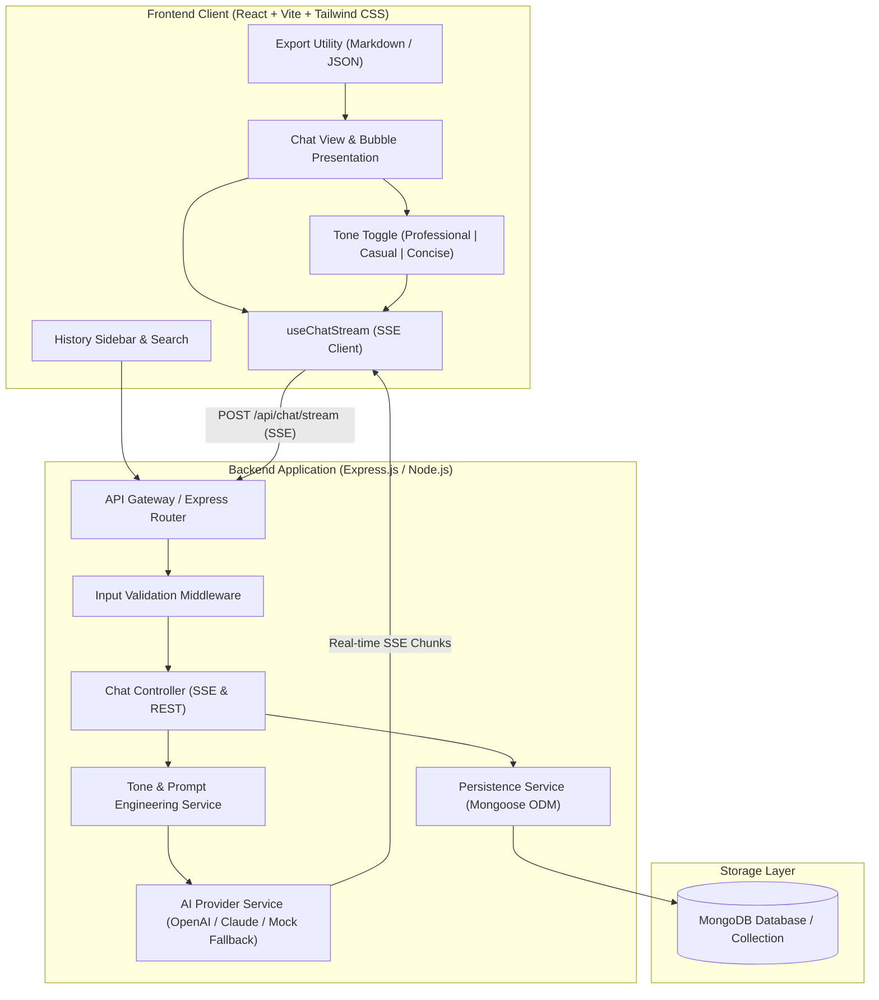

# System Architecture Document

## Project: Quantiphi Intelligent AI Chat Assistant
**Author:** Candidate  
**Date:** November 20, 2026  
**Architecture Pattern:** Decoupled Client-Server (REST + Server-Sent Events / SSE) with MongoDB Document Persistence

---

## 1. High-Level Architecture Overview

The system is structured as a decoupled, full-stack architecture comprising a responsive Single Page Application (SPA) frontend, an Express.js API server handling business logic and AI integration, and a MongoDB persistence layer.



---

## 2. Directory Structure

The repository maintains strict separation of concerns between client and server:

```
Quantiphi_AIChat/
├── client/                     # Frontend Application (React + Vite + Tailwind)
│   ├── public/                 # Static assets & icons
│   ├── src/
│   │   ├── components/         # UI Components
│   │   │   ├── ChatInterface.jsx   # Message list, auto-scroller, typing indicator
│   │   │   ├── ChatBubble.jsx      # Distinct User/AI bubbles, markdown, code highlighting
│   │   │   ├── HistorySidebar.jsx  # Past conversations list, search bar, new chat button
│   │   │   ├── ToneSelector.jsx    # Professional / Casual / Concise switch
│   │   │   ├── ExportModal.jsx     # Markdown / JSON download dialog
│   │   │   └── CodeBlock.jsx       # Syntax highlighting with one-click copy button
│   │   ├── hooks/
│   │   │   ├── useChatStream.js    # Handles SSE connection, chunk assembly, aborts
│   │   │   └── useConversations.js # Handles fetching, creating, and deleting threads
│   │   ├── services/
│   │   │   └── api.js              # Centralized Axios / Fetch wrappers
│   │   ├── styles/                 # Tailwind CSS styles and custom animations
│   │   ├── App.jsx                 # Main layout wrapper
│   │   └── main.jsx                # React root entrypoint
│   ├── package.json
│   ├── vite.config.js
│   └── tailwind.config.js
│
├── server/                     # Backend Application (Node.js + Express)
│   ├── src/
│   │   ├── config/             # DB connection, environment variables
│   │   │   └── db.js
│   │   ├── controllers/        # Request handlers
│   │   │   └── chatController.js
│   │   ├── models/             # Mongoose schemas
│   │   │   └── Conversation.js
│   │   ├── routes/             # REST & SSE route definitions
│   │   │   └── chatRoutes.js
│   │   ├── services/           # Business logic & AI abstractions
│   │   │   ├── aiService.js    # OpenAI/Claude client + resilient stream generator
│   │   │   └── promptService.js# Tone prompt modifiers ("The Vibe Check")
│   │   ├── middleware/         # Error handling and payload validators
│   │   │   └── errorHandler.js
│   │   └── app.js              # Express app bootstrap
│   ├── server.js               # HTTP server listener
│   └── package.json
│
├── prd.md                      # Product Requirements Document
├── architecture.md             # System Architecture Document
├── design_system.md            # UI/UX & Design Tokens Document
├── tasks.md                    # Implementation & Milestones Plan
└── README.md                   # Installation & Evaluation Guide
```

---

## 3. Data Schema & Persistence Model

The MongoDB persistence layer uses a normalized yet flexible document model designed for high-performance reading and appending of messages.

### Conversation Document Schema (`conversations` collection):

```javascript
{
  _id: ObjectId("..."),
  title: String,             // Auto-generated from initial prompt (e.g., "Exploring React Hooks")
  tone: {
    type: String,
    enum: ["Professional", "Casual", "Concise"],
    default: "Professional"
  },
  messages: [
    {
      _id: ObjectId("..."),
      role: { type: String, enum: ["user", "assistant", "system"] },
      content: String,
      tone: String,
      timestamp: { type: Date, default: Date.now },
      tokens: Number         // Optional metric for evaluation insight
    }
  ],
  createdAt: { type: Date, default: Date.now },
  updatedAt: { type: Date, default: Date.now }
}
```

### Database Optimization:
- **Index**: `{ updatedAt: -1 }` on `conversations` for fast sidebar query sorting.
- **Projection**: Sidebar endpoint queries `_id`, `title`, `updatedAt`, and message count without transmitting full message bodies, optimizing payload size.

---

## 4. API Endpoints Specification

### 4.1 Server-Sent Events (SSE) Streaming
- **Route**: `POST /api/chat/stream`
- **Headers**:
  - `Content-Type: text/event-stream`
  - `Cache-Control: no-cache`
  - `Connection: keep-alive`
- **Request Body**:
  ```json
  {
    "conversationId": "65fc... (optional, creates new thread if null)",
    "prompt": "Explain asynchronous programming in JavaScript",
    "tone": "Professional"
  }
  ```
- **Stream Protocol**:
  1. `event: metadata\ndata: {"conversationId": "...", "title": "..."}\n\n`
  2. `event: chunk\ndata: {"delta": "Asynchronous "}\n\n`
  3. `event: chunk\ndata: {"delta": "programming "}\n\n`
  4. `event: done\ndata: {"messageId": "...", "totalChars": 450}\n\n`
  5. `event: error\ndata: {"message": "..."}\n\n` (if error occurs)

### 4.2 Conversation Management Endpoints
- `GET /api/conversations`: List all conversation summaries (title, id, last updated, message count).
- `GET /api/conversations/:id`: Retrieve complete conversation thread with all message history.
- `DELETE /api/conversations/:id`: Delete a conversation thread.
- `PATCH /api/conversations/:id/title`: Rename a conversation thread.

---

## 5. "The Vibe Check" System Instruction Engine

To satisfy the core requirement of instantly modifying AI response styles, `promptService.js` maintains modular system instructions:

```javascript
const TONE_SYSTEM_PROMPTS = {
  Professional: `You are an elite, highly professional AI assistant. 
Your tone is articulate, polished, objective, and executive-ready. 
Use clear structure, structured lists, and avoid colloquialisms.`,

  Casual: `You are a friendly, witty, and approachable AI companion. 
Your tone is conversational, empathetic, and relaxed. 
Feel free to use casual phrasing, relatable metaphors, and an engaging vibe.`,

  Concise: `You are a razor-sharp, ultra-concise AI assistant. 
Deliver maximum value with minimum words. 
Do not include conversational filler, greetings, or pleasantries. Output only direct, accurate answers.`
};
```

---

## 6. Resiliency, Scalability & Fallback Strategies

To ensure that evaluation proceeds flawlessly regardless of whether an external API key or local MongoDB daemon is pre-installed:
1. **Multi-Model Provider Service**:
   - If `OPENAI_API_KEY` or `ANTHROPIC_API_KEY` is present, the server routes requests to OpenAI (`gpt-4o-mini` / `gpt-3.5-turbo`) or Claude.
   - If no API key is configured, the server automatically transitions to an **Intelligent Mock Streaming Engine** that emulates realistic LLM token generation with tone adaptation, code syntax generation, and character-by-character SSE delivery.
2. **Database Fallback**:
   - Primary: Connects to `MONGODB_URI` (Docker, Atlas, or local service).
   - Secondary: Seamless in-memory MongoDB runner fallback if no local MongoDB service is actively listening, ensuring 100% zero-friction evaluation.

---

## 7. Security & Server-Side Enforcement
- Cross-Origin Resource Sharing (CORS) restricted to trusted origins.
- Server-side input sanitization and payload limits (`express.json({ limit: '1mb' })`).
- Comprehensive error boundary middleware to prevent uncaught exceptions from tearing down SSE streams.
